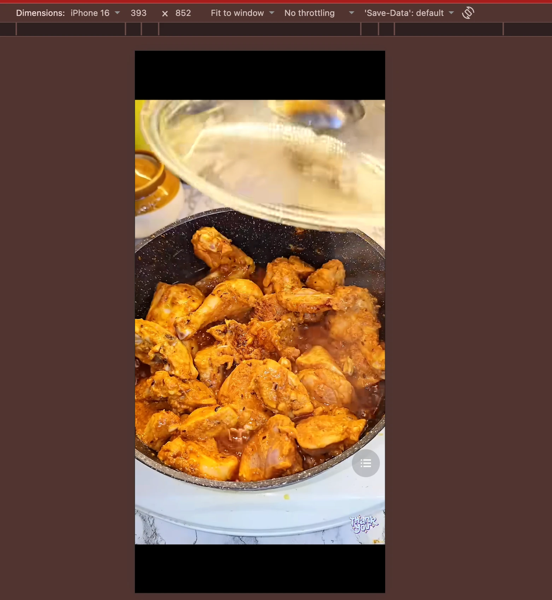
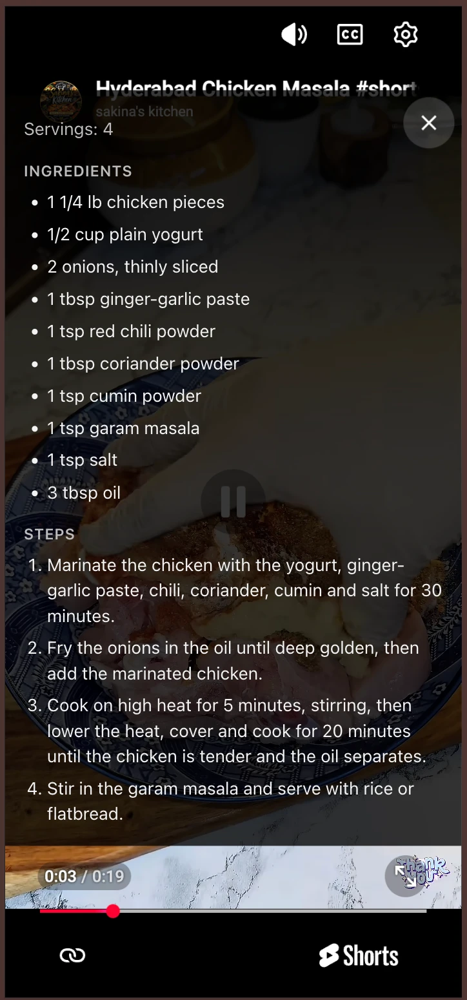
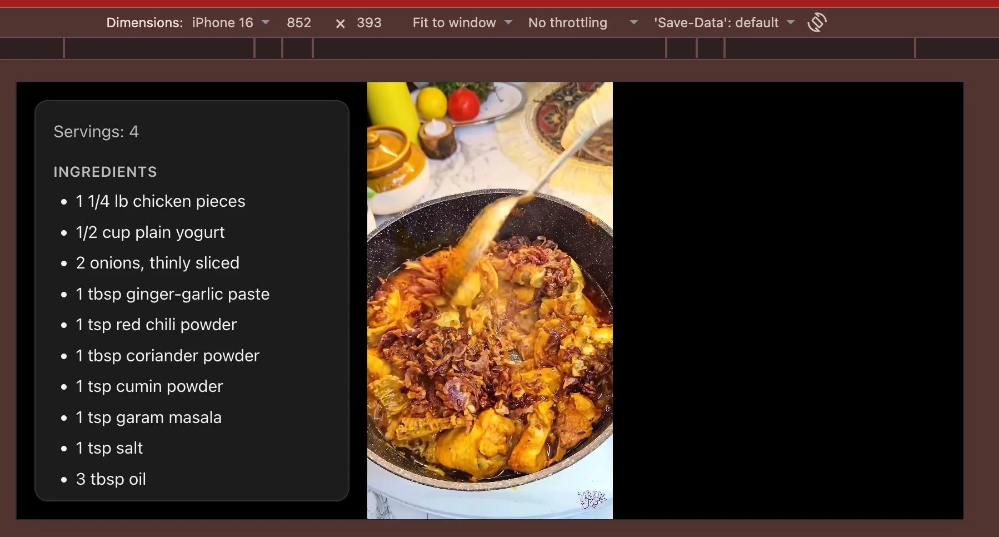
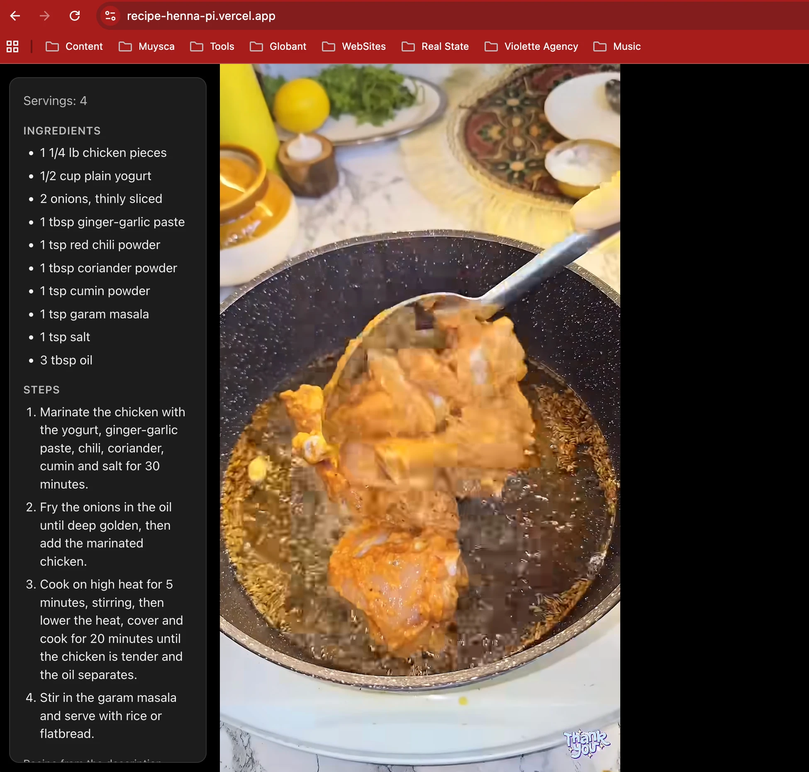

# Easy Recipes from YouTube (working title)

A mobile-first web app with a vertical, full-screen feed of short YouTube
cooking videos (Shorts), each with an easy written recipe.

> Status: **final delivery (Entrega final).** Three must-have features work
> end to end in production: the **swipe feed** (24 curated Shorts read from
> Postgres through `GET /api/feed`), **playback** (muted autoplay, one tap to
> unmute, loop) and the **recipe next to the video** (a panel where there is
> room, a Recipe button and sheet on a phone in portrait). 21 of the 24 videos
> carry a placeholder recipe written from the title, not extracted (see
> [docs/development.md](docs/development.md#placeholder-recipes-for-the-curated-shorts));
> 3 show their title only. Favorites, sharing, deep links, daily ingestion and
> LLM extraction are not built. **How to verify the three features, with
> screenshots: [docs/verify-features.md](docs/verify-features.md).**
> Delivery progress: [docs/checklist.md](docs/checklist.md).

## Index

0. [Project info](#0-project-info)
1. [Product overview](#1-product-overview)
2. [System architecture](#2-system-architecture)
3. [Data model](#3-data-model)
4. [API specification](#4-api-specification)
5. [User stories](#5-user-stories)
6. [Work tickets](#6-work-tickets)
7. [Pull requests](#7-pull-requests)

**More documentation:** [how this project is built with AI](docs/ai-workflow.md)
· [documentation map](docs/README.md)

---

## 0. Project info

| | |
|---|---|
| **Author** | Juan Pablo Aljure |
| **Project name** | Easy Recipes from YouTube (working title) |
| **Short description** | A vertical feed of YouTube cooking Shorts, each with an easy recipe (servings, ingredients, numbered steps) extracted ahead of time by an LLM. |
| **Project URL** | [recipe-henna-pi.vercel.app](https://recipe-henna-pi.vercel.app) |
| **Repository** | [github.com/jpabloaljure/recipe](https://github.com/jpabloaljure/recipe) |

---

## 1. Product overview

### 1.1. Objective

Short cooking videos are fun to watch but hard to cook from: the recipe goes
by fast, often has no written version, or is buried in a description or
comment. Easy Recipes is for the **casual home cook** (limited time, watches
on a phone) who wants something quick to cook today: swipe through easy
recipe videos and read the recipe without pausing and rewinding.

### 1.2. Main features

| Feature | Status | What it does |
|---|---|---|
| **1. Feed** | Built (REC-001, REC-002, REC-018) | Vertical, one full-screen video at a time, swipe to move, next page loaded ahead, wrap to the start, error and empty states. |
| **2. Playback** | Built (REC-003, REC-004) | Muted autoplay of the active video only, one tap to unmute (kept in the tab), loop, pause when out of view, the next video ready before the swipe. |
| **3. Recipe** | Built (REC-006, REC-022) | Servings, ingredients, numbered steps and the source: a panel beside the video where there is room, a Recipe button and sheet on a phone in portrait; a video with no recipe shows its title only. |
| Favorites | Not built (REC-011, REC-012) | Saved in the browser, no account. |
| Sharing | Not built (REC-013, REC-014) | Native share sheet or copy link; deep links to a recipe. |
| Daily ingestion and extraction | Not built (REC-005, REC-008) | Finds new Shorts, extracts recipes with an LLM and keeps only easy ones. Today a one-time loader fills the database from a curated list. |

Full requirements, scope and performance targets: [PRD](docs/PRD.md).

### 1.3. Design and user experience

Step-by-step checks of the three features, with these screenshots of the
production app: **[docs/verify-features.md](docs/verify-features.md)**.

| Phone in portrait: feed and Recipe button | Phone in portrait: recipe sheet |
|---|---|
|  |  |

| Phone in landscape: recipe panel | Desktop: recipe panel and video |
|---|---|
|  |  |

### 1.4. Installation

Prerequisites: Node 26+, pnpm, and Docker for the local database.

```bash
pnpm install                 # install dependencies
cp .env.example .env.local   # local settings (git-ignored)
pnpm db:up                   # local Postgres 17 in Docker
pnpm db:setup                # the read-only role the app uses
pnpm db:migrate              # create the tables
pnpm db:seed                 # made-up videos for the feed
pnpm dev                     # dev server at http://localhost:3000
pnpm test                    # unit tests (no database needed)
pnpm test:db                 # database tests
pnpm test:e2e                # end-to-end tests
```

Setup details, the database, E2E tests and testing a deployed site:
[docs/development.md](docs/development.md).

---

## 2. System architecture

### 2.1. Architecture diagram

Two paths: a **request path** (browser → Vercel CDN → Next.js API → Postgres,
with cached feed responses) and a **batch path** (a daily GitHub Actions job
that finds videos, extracts recipes with an LLM and writes to Postgres). The
LLM is never called while a user is browsing.

Diagrams (C4 model, Mermaid): [docs/architecture/](docs/architecture/README.md)
· Reasons, benefits and trade-offs: [ADRs](docs/adr/README.md).

### 2.2. Main components

| Component | Technology | Decision |
|---|---|---|
| Web app + API | Next.js (App Router), React 19, TypeScript, CSS modules | [ADR 0002](docs/adr/0002-nextjs-on-vercel.md) |
| Database | Postgres on Neon, Drizzle ORM | [ADR 0003](docs/adr/0003-postgres-neon-drizzle.md) |
| Ingestion job | Node TypeScript script on a GitHub Actions schedule | [ADR 0004](docs/adr/0004-ingestion-on-github-actions.md) |
| Hosting + CDN | Vercel | [ADR 0002](docs/adr/0002-nextjs-on-vercel.md) |
| Video playback control | YouTube IFrame Player API (external script, no npm dependency) | [ADR 0008](docs/adr/0008-youtube-iframe-player-api.md) |

### 2.3. Project structure

One package for the web app and the ingestion job
([ADR 0005](docs/adr/0005-single-package-repository-layout.md)).

```
src/        web app and API (Next.js App Router)
e2e/        end-to-end tests (Playwright)
docs/       PRD, architecture, ADRs, API spec, process
backlog/    user stories, one file per epic
openspec/   OpenSpec specs and changes
.github/    CI and production smoke check
.agents/    AI skills
```

Full tree: [docs/architecture/repository-layout.md](docs/architecture/repository-layout.md).

### 2.4. Infrastructure and deployment

Vercel deploys `main` to production on every merge. `main` is protected:
every change goes through a pull request with CI green. After each deploy, a
smoke test runs against production. Flow:
[CONTRIBUTING.md](CONTRIBUTING.md).

The database is Postgres on Neon. The app reads it as a read-only role; schema
changes are migrations in the repo, reviewed in a pull request and applied to
production by a workflow after the merge
([ADR 0007](docs/adr/0007-database-connections-roles-and-migrations.md),
[docs/development.md](docs/development.md#production-migrations)).

Secrets are never committed. `DATABASE_URL` (the pooled connection as the
read-only role) is set in Vercel for Production and Preview.
`DATABASE_URL_DIRECT` (the owner role, direct connection) is only in GitHub
Actions secrets: the migration workflow and the curated loader use it, the web
app never sees it. `.env.example` holds only local development values; how to
set the real ones is in
[docs/development.md](docs/development.md#create-the-neon-project-production).

### 2.5. Security

The app is a public, read-only feed with no accounts and no user data on the
server, so the practices target a leaked write credential, an unreviewed change
reaching production, and bad input on the one public endpoint. The main ones:

- **Read-only app.** It connects as `app_readonly` (`SELECT` only); the write
  credential lives only in GitHub Actions secrets.
- **Rules in the database.** Triggers and constraints hold for every writer,
  including a console edit.
- **Strict input checks.** The feed `cursor` is validated and bounded; a bad
  one is a `400` and never reaches Postgres. Errors return a generic message.
- **Parameterized queries** (Drizzle and `pg`); no `eval` or raw HTML.
- **Privacy-enhanced embed** (`youtube-nocookie.com`, explicit `allow` list,
  referrer policy).
- **Protected `main`.** A pull request, a green `check`, an up-to-date branch
  and resolved review conversations are required, admins included; writes to
  production run only from `main`.
- **Pinned dependencies** and installs from the lockfile.

Each practice with its example and source file, and the known gaps (no security
headers, no Dependabot, no rate limiting), are in
[docs/security.md](docs/security.md).

### 2.6. Tests

- **Unit (Vitest, 218 tests):** feed logic, cursor, route handler, playback
  rules, recipe text, loaders. No database needed.
- **Database (Vitest, `pnpm test:db`):** the schema, triggers, read-only role
  and the feed query against a real Postgres.
- **End-to-end (Playwright, Chromium):** about 100 scenarios named after the
  specs in `openspec/specs/`, each run on three screens (phone portrait, phone
  landscape, desktop; 315 test runs), on every pull request
  ([ADR 0006](docs/adr/0006-playwright-end-to-end-tests.md)). The main flow
  (open the feed, swipe, unmute, open the recipe) is covered by `e2e/feed/`,
  `e2e/playback/` and `e2e/recipe-panel/`.
- **Production smoke:** the `@smoke` E2E test after each deploy.
- **Manual:** touch-flick physics and the YouTube player's own controls on
  real phones, recorded in each change's tasks.

How to run them: [docs/development.md](docs/development.md).

---

## 3. Data model

A video has zero or one recipe; the video's status decides whether it is in
the feed. ER diagram, fields, types, keys and rules:
[docs/architecture/data-model.md](docs/architecture/data-model.md).

---

## 4. API specification

| Endpoint | Returns |
|---|---|
| `GET /api/feed` | One page of the feed: `ready` videos with their recipe, `needs_recipe` videos with their title only |
| `GET /api/videos/{youtubeId}` | One feed video, for deep links. **Specified, not built** (REC-014) |

OpenAPI 3.1 spec with schemas and examples:
[docs/api/openapi.yaml](docs/api/openapi.yaml).

---

## 5. User stories

Three of the stories that drive the three features (all stories:
[backlog/](backlog/README.md)); each has Given/When/Then criteria, a team
estimate and passing E2E tests:

- [**REC-001** · Vertical full-screen feed with manual swipe](backlog/E01-browse-feed.md#rec-001--vertical-full-screen-feed-with-manual-swipe)
  (feature 1): as a home cook, I want to swipe through short recipe videos
  one at a time, so that I can quickly find something to cook today.
- [**REC-003** · Autoplay muted, tap to unmute, loop](backlog/E01-browse-feed.md#rec-003--autoplay-muted-tap-to-unmute-loop)
  (feature 2): as a home cook, I want each video to start playing by itself
  and to turn the sound on with one tap, so that I can watch without setup.
- [**REC-006** · Recipe panel with servings, ingredients and steps](backlog/E02-recipe-every-video.md#rec-006--recipe-panel-with-servings-ingredients-and-steps)
  (feature 3): as a home cook, I want the recipe next to the video, so that I
  can cook from it without pausing and rewinding. Its phone-portrait slice is
  [REC-022](backlog/E02-recipe-every-video.md#rec-022--recipe-button-and-sheet-when-there-is-no-room-for-the-panel).

Other validated stories: REC-002 (feed with ready and title-only videos),
REC-004 (instant next video), REC-018 (empty, error and unavailable states),
REC-019 (database schema), REC-020 (data model document), REC-021 (API
specification document).

---

## 6. Work tickets

Tickets are backlog stories with a `layer:` label (no separate tracker; see
[story slicing](AGENTS.md#story-slicing)):

| Layer | Ticket |
|---|---|
| Database | [REC-019 · Database schema and migration for the video catalog](backlog/E01-browse-feed.md#rec-019--database-schema-and-migration-for-the-video-catalog): the `video` and `recipe` tables, four migrations, triggers, the read-only role |
| Backend | [REC-002 · Feed shows ready and title-only videos, newest first with variety](backlog/E01-browse-feed.md#rec-002--feed-shows-ready-and-title-only-videos-newest-first-with-variety): `GET /api/feed` with a cursor, cache headers and a curated-list loader (full-stack slice, mostly API and database) |
| Frontend | [REC-006 · Recipe panel with servings, ingredients and steps](backlog/E02-recipe-every-video.md#rec-006--recipe-panel-with-servings-ingredients-and-steps) (`layer:frontend`) |

---

## 7. Pull requests

- [#43 REC-001: Vertical swipe feed with a stub feed API](https://github.com/jpabloaljure/recipe/pull/43):
  the first feature, with the first AI code review (5 findings fixed).
- [#59 REC-002: Feed reads the database, with a per-page shuffle and a curated-list loader](https://github.com/jpabloaljure/recipe/pull/59):
  connects the app to Postgres on Neon.
- [#100 REC-022: Recipe button and sheet](https://github.com/jpabloaljure/recipe/pull/100):
  the recipe on a phone in portrait, with 23 new E2E tests and an AI review
  whose three findings were fixed before merge.
