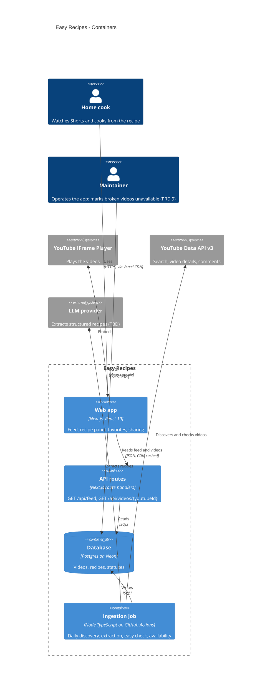

# Easy Recipes from YouTube (working title)

A mobile-first web app with a vertical, full-screen feed of short YouTube
cooking videos (Shorts). Videos come with an easy recipe (servings,
ingredients, numbered steps), extracted ahead of time by an LLM; a video whose
recipe could not be found shows its title only.

> Status: **MVP planning.** The PRD and backlog are written, and the app is
> scaffolded (a placeholder page, no product features yet). Delivery progress
> is tracked in [docs/checklist.md](docs/checklist.md).

## Project info

| | |
|---|---|
| **Name** | TBD (working title "Easy Recipes from YouTube"; PRD §12) |
| **Author** | TBD |
| **Repository** | [github.com/jpabloaljure/recipe](https://github.com/jpabloaljure/recipe) (branch `main`) |
| **Deployed URL** | [recipe-henna-pi.vercel.app](https://recipe-henna-pi.vercel.app) (Vercel, deploys from `main`) |
| **PRD status** | Draft v0.3, updated 2026-11-17 |
| **Platform** | Web app, mobile-first, desktop supported |

## Overview

### Problem
Short cooking videos are fun to watch but hard to cook from: the recipe goes
by fast, often has no written version, or is buried in a description or
comment. Users pause, rewind and take their own notes.

### Target user
The **casual home cook**: limited time and experience, wants something quick
to cook today, watches on a phone.

### MVP goals
1. Browse a curated feed of easy recipe Shorts with no waiting.
2. See the written recipe for every video in the feed that has one (a video
   with no recipe found shows its title only).
3. Save favorites and share recipes without creating an account.

### Features (MVP)
- **Feed:** vertical, one video at a time, swipe to move, no autoscroll.
- **Playback:** muted autoplay, one tap to unmute for the session, loop, pause
  when out of view.
- **Recipe panel:** servings, ingredients with quantities, numbered steps, and
  the source (description, comment or captions) with a link to YouTube. Opens
  automatically after the first play-through.
- **Favorites:** saved in the browser (localStorage), no account.
- **Sharing:** native share sheet or copy link; deep links `/r/{videoId}`.
- **Ingestion (background):** a daily job discovers English, embeddable Shorts
  (≤ 3 min); an LLM extracts the recipe; only "easy" recipes (≤ 10
  ingredients, ≤ 30 min active, common equipment) enter the feed.

### Out of scope (MVP)
User accounts and sync, search and filters, step timestamps, time/difficulty
display, user-submitted URLs, languages other than English, analytics, admin
UI, native apps. See PRD §4 and the post-MVP roadmap in PRD §10.

### Performance targets
| ID | Target |
|---|---|
| PERF-1 | Recipe extraction never runs while a user is browsing |
| PERF-2 | First video playable in < 2 s on a mid-range phone over 4G |
| PERF-3 | Next video starts in < 500 ms after a swipe |
| PERF-4 | Recipe panel opens instantly (data arrives with the feed) |
| PERF-5 | At most 3 video players alive (previous, current, next) |
| PERF-6 | Feed responses are cacheable (CDN/edge) |

Full product requirements: [docs/PRD.md](docs/PRD.md).

## Architecture

Documented with the C4 model in Mermaid; see
[docs/architecture/](docs/architecture/README.md) for all levels and
[docs/adr/](docs/adr/README.md) for the decisions behind them.

| C4 level | Diagram | Status |
|---|---|---|
| 1. System context | [01-system-context.md](docs/architecture/c4/01-system-context.md) | Current |
| 2. Containers | [02-containers.md](docs/architecture/c4/02-containers.md) | Current |
| 3. Web app components | [03-components-web-app.md](docs/architecture/c4/03-components-web-app.md) | Proposed |
| 3. Ingestion components | [03-components-ingestion.md](docs/architecture/c4/03-components-ingestion.md) | Proposed |

### Containers (C4 level 2)



- **Request path:** browser -> Vercel CDN -> Next.js route handler ->
  Postgres. Feed and video responses are CDN-cached, so most requests stop at
  the CDN (PERF-6).
- **Batch path:** a GitHub Actions schedule runs the ingestion job daily:
  discovery, LLM extraction, "easy" check, availability check, writes to
  Postgres. Nothing in the request path calls the LLM (PERF-1).

### Decisions (ADRs)

| ADR | Decision |
|---|---|
| [0001](docs/adr/0001-record-architecture-decisions.md) | Record architecture decisions as ADRs, with C4 diagrams in Mermaid |
| [0002](docs/adr/0002-nextjs-on-vercel.md) | Next.js (App Router) on Vercel for the web app and API |
| [0003](docs/adr/0003-postgres-neon-drizzle.md) | Postgres on Neon with Drizzle ORM |
| [0004](docs/adr/0004-ingestion-on-github-actions.md) | Daily ingestion as a TypeScript script on GitHub Actions |
| [0005](docs/adr/0005-single-package-repository-layout.md) | Single-package repository layout |
| [0006](docs/adr/0006-playwright-end-to-end-tests.md) | Playwright for end-to-end tests (Chromium only) |

Pending decisions (LLM provider, captions source, favorites recipe copy) are
listed in [docs/adr/README.md](docs/adr/README.md#pending-decisions).

## Tech stack

| Layer | Choice |
|---|---|
| Language | TypeScript everywhere |
| Web app + API | Next.js (App Router) with React 19 |
| Styling | Plain CSS modules |
| Database | Postgres on Neon |
| Data access + migrations | Drizzle ORM |
| Daily ingestion | Node TypeScript script on a GitHub Actions schedule |
| Hosting + CDN | Vercel |
| Package manager / tests | pnpm, Vitest (unit), Playwright (end-to-end, Chromium) |
| LLM provider | TBD |

Constraints from the PRD:

- Videos must play in the official YouTube embedded player (IFrame Player
  API); never downloaded or re-hosted.
- Favorites use browser localStorage.
- Sharing uses the Web Share API with a copy-link fallback.

## Data model

The full model, with the ER diagram, field types, keys and rules, is in
[docs/architecture/data-model.md](docs/architecture/data-model.md)
(`Status: Proposed` until the schema, REC-019, is built). In short:

- **Video** (key `id`, unique `youtube_id`): title, channel, the candidate
  facts (duration, embeddable, language), status, and the time it entered
  the feed.
- **Video status:** `ready` (in feed, with recipe), `needs_recipe` (in feed,
  title only), `not_easy`, `unavailable`, `rejected` (failed ING-2, kept so
  it is skipped) (PRD §6.4).
- **Recipe** (0 or 1 per video): `servings`, `ingredients[] {name, quantity,
  unit}`, `steps[]`, the source used (`description` / `comment` /
  `captions`), and the raw "easy" facts `ingredient_count`,
  `estimated_active_minutes`, `special_equipment[]`, so thresholds can
  change without reprocessing. Adding recipes by hand is not in the MVP.

## API specification

The contract is [docs/api/openapi.yaml](docs/api/openapi.yaml) (OpenAPI
3.1, owned by REC-021; REC-002 and REC-014 implement it). Two read-only route
handlers, cached at the Vercel CDN (ADR 0002):

| Endpoint | Returns | Errors | Caching |
|---|---|---|---|
| `GET /api/feed?cursor=` | `{ items, nextCursor }`: up to 10 items, newest first by feed-entry time; `nextCursor` is `null` on the last page. Leave `cursor` out for the first page. | 400 `invalid_cursor`, 5xx `internal_error` | `s-maxage=3600`; empty feed `no-store` |
| `GET /api/videos/{youtubeId}` | One item, for `ready` and `needs_recipe` videos (deep links) | 404 `not_found` (unknown, malformed or out-of-feed ID), 5xx `internal_error` | `s-maxage=3600`; errors `no-store` |

Each item is `{ youtubeId, title, channelName, recipe }`; `recipe` holds
`servings`, `ingredients[{name, quantity, unit}]`, `steps[]` and `source`, and
is `null` for a title-only video. Fields with no value are `null`. Errors use
one body, `{ "error": { "code", "message" } }`. The file also maps each field
to its data model column.

Required behavior (PRD §6.5):

| ID | Behavior |
|---|---|
| API-1 | Paginated feed of `ready` videos with their recipe and `needs_recipe` videos with their title only |
| API-2 | Feed order: newest first, with light shuffling (done by the client, per page) |
| API-3 | A single video in the feed by its YouTube ID (for deep links); any other ID is not found |

## Backlog

User stories live in [backlog/](backlog/README.md), one file per epic, mapped
to the PRD goals:

| Epic | Stories |
|---|---|
| [E01 Browse a curated feed with no waiting](backlog/E01-browse-feed.md) | REC-001 to REC-005, REC-018 to REC-021 |
| [E02 A written recipe for every video that has one](backlog/E02-recipe-every-video.md) | REC-006 to REC-010, REC-017 |
| [E03 Save and share without an account](backlog/E03-save-and-share.md) | REC-011 to REC-014 |
| [E04 Launch readiness](backlog/E04-launch-readiness.md) | REC-015, REC-016 |

There are 21 stories. REC-001, REC-020 and REC-021 are validated and
estimated; REC-002 and REC-003 are in review; the other 16 are still flagged
`needs-human-validation`, so they cannot be started. Validation is in progress
with the `validate-backlog` skill ([log](backlog/validation-log.md)).

**Work tickets (backend, frontend, database).** Stories are full-stack slices
by default and are split by layer only when needed (AGENTS.md, "Story
slicing"). Every story has one `layer:` label: database (REC-019, REC-020),
backend (REC-005, REC-008, REC-009, REC-010, REC-016, REC-017, REC-021),
frontend (REC-001, REC-003, REC-004, REC-006, REC-007, REC-011 to REC-013,
REC-015, REC-018) and full stack (REC-002, REC-014). The
[Entrega 1 checklist](docs/checklist.md) (item 10) tracks them.

## Repository structure

```
.
+-- README.md              this file
+-- AGENTS.md              context and rules for AI agents
+-- CLAUDE.md              symlink to AGENTS.md (for Claude Code)
+-- docs/
|   +-- PRD.md             product requirements (source of truth)
|   +-- prompts.md         log of the prompts used to build this setup
|   +-- checklist.md       delivery checklist
|   +-- architecture/      C4 diagrams (Mermaid)
|   +-- adr/               architecture decision records
+-- backlog/               user stories, one file per epic
+-- openspec/              OpenSpec specs and changes
+-- src/
|   +-- app/               Next.js App Router (pages; later API route handlers)
|   +-- lib/               shared code (later the Drizzle schema and feed types)
+-- package.json           one package for the web app and ingestion (ADR 0005)
+-- .github/workflows/     CI: typecheck, test, build
+-- .agents/skills/        AI skills (shared by Claude Code, Cursor, Codex)
+-- .claude/
    +-- settings.json      registers the backlog hook
    +-- launch.json        dev server for the in-app browser preview
    +-- hooks/validate-ac.sh
    +-- skills/            symlinks to .agents/skills/
```

## AI-assisted workflow

This project is planned with AI agents. The pieces:

- **[AGENTS.md](AGENTS.md):** project context and backlog rules for every
  agent; `CLAUDE.md` links to it.
- **Skills:**
  - `decompose-prd`: turns the PRD into epics and user stories.
  - `validate-story`: lists a story's edge cases, assumptions, missing
    scenarios and risks, without rewriting it.
  - `validate-backlog`: validates stories one at a time with the human
    (review, criteria approval, AI estimate, team estimate); resumable. Uses
    the `story-validator` agent.
  - `estimate-story`: gives Fibonacci story points (1, 2, 3, 5, 8, 13) as
    one voice in planning poker, after the criteria are approved.
  - `write-adr`: records an architecture decision and updates the C4
    diagrams.
  - `openspec-*`: OpenSpec workflow (explore, propose, apply, archive, sync).
- **Story slicing:** stories are full-stack slices by default and are split
  by layer only when needed; every story has a `layer:` label
  (`fullstack`, `db`, `backend`, `frontend`). See "Story slicing" in
  [AGENTS.md](AGENTS.md).
- **Estimation:** `size:*` labels are t-shirt sizes (S/M/L/XL); the AI
  estimate and the team `Estimate` are Fibonacci points. See
  [backlog/README.md](backlog/README.md#estimation).
- **Hook `validate-ac.sh`:** blocks any backlog edit that would mark a story
  `done` without Given/When/Then criteria, start a story still flagged
  `needs-human-validation`, remove that flag before a team `Estimate` is set,
  or use an estimate outside `1|2|3|5|8|13` or `spike <N>h`.
- **OpenSpec:** the "how" (specs, design, tasks) goes here once stories are
  validated. The first change, `choose-tech-stack`, picked the stack and set
  up the architecture docs. Designs that make an architecture decision must
  name their ADRs and C4 updates (`openspec/config.yaml`).
- **Contributing:** [CONTRIBUTING.md](CONTRIBUTING.md) (branches, pull
  requests, AI review, merge, production smoke check), with the
  [Definition of Ready](docs/process/definition-of-ready.md) and the
  [Definition of Done](docs/process/definition-of-done.md).
- **Prompt log:** [docs/prompts.md](docs/prompts.md).

## Getting started

Prerequisites: Node 26 or later (see `.nvmrc`) and pnpm
(`npm install -g pnpm`; Node 25+ no longer ships Corepack).

```bash
pnpm install      # install dependencies
pnpm dev          # dev server at http://localhost:3000
pnpm test         # unit tests (Vitest)
pnpm typecheck    # TypeScript strict check
pnpm build        # production build
```

End-to-end tests (Playwright, Chromium only; rules in `AGENTS.md`):

```bash
pnpm exec playwright install chromium   # once: download the test browser
pnpm test:e2e                           # build, start and test on 3 screen sizes
pnpm test:e2e --grep @smoke             # smoke test only
```

`pnpm test:e2e` reuses a server already running on port 3000; stop
`pnpm dev` first so the tests run against the production build.

To test a deployed site instead, set `BASE_URL`; Playwright then starts no
local server. The production smoke check (run automatically after each
production deploy, see [CONTRIBUTING.md](CONTRIBUTING.md#production-smoke-check)):

```bash
BASE_URL=https://recipe-henna-pi.vercel.app pnpm test:e2e --grep @smoke --project=desktop --project=phone-portrait
```

The app is a placeholder page for now. No database or environment variables
are needed yet.

## Open questions

From PRD §12:
- Product name and branding.
- Seed channels and search queries for discovery.
- Is it legal to get captions/transcripts for third-party videos? (spike
  REC-009)
- Should favorites save a copy of the recipe in case the video is removed?

Backlog-level open decisions are listed in
[backlog/README.md](backlog/README.md#open-decisions).
