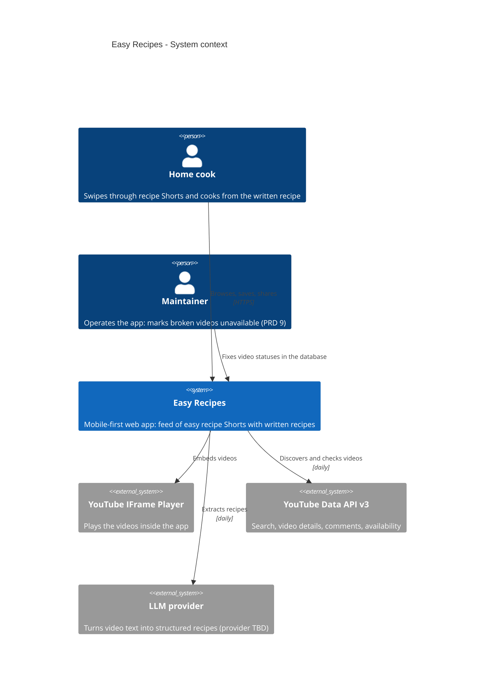

# C4 Level 1: System context

Status: Current

Who uses Easy Recipes and which external systems it depends on.

## Notes

- Video streams come from YouTube, never from our servers (PRD §9).
- The LLM is called only by the daily ingestion job, never while a user is
  browsing (PERF-1).

## Related ADRs

- [0001 Record architecture decisions](../../adr/0001-record-architecture-decisions.md)
- [0004 Ingestion on GitHub Actions](../../adr/0004-ingestion-on-github-actions.md)
