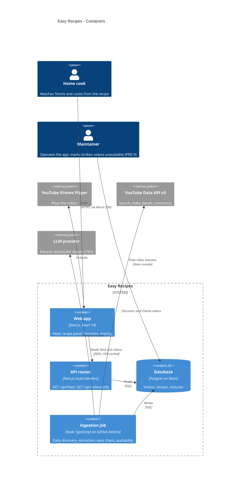

# C4 Level 2: Containers

Status: Current

The deployable parts of Easy Recipes and how they communicate.

## Paths

- **Request path:** browser -> Vercel CDN -> Next.js route handler ->
  Postgres. Feed and video responses are CDN-cached (`s-maxage` with
  revalidation), so most requests stop at the CDN (PERF-6).
- **Batch path:** GitHub Actions runs the ingestion job daily. It writes
  videos, recipes and statuses to Postgres. It shares the Drizzle schema and
  types with the web app.
- **Favorites** live in the browser's localStorage, inside the web app
  container (PRD §5.4).

## Related ADRs

- [0002 Next.js on Vercel](../../adr/0002-nextjs-on-vercel.md)
- [0003 Postgres on Neon with Drizzle](../../adr/0003-postgres-neon-drizzle.md)
- [0004 Ingestion on GitHub Actions](../../adr/0004-ingestion-on-github-actions.md)
- [0005 Single-package repository layout](../../adr/0005-single-package-repository-layout.md)
