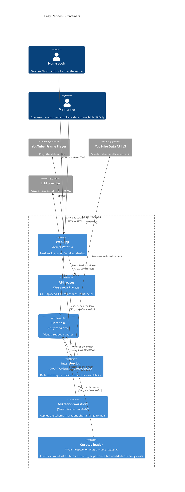

# C4 Level 2: Containers

Status: Current

The deployable parts of Easy Recipes and how they communicate.

## Paths

- **Request path:** browser -> Vercel CDN -> Next.js route handler ->
  Postgres. Feed pages and video responses that carry videos are cached by
  the CDN for 1 hour (`s-maxage=3600`); empty and error responses are not
  (`no-store`). Most requests stop at the CDN (PERF-6).
- **Batch path:** GitHub Actions runs the ingestion job daily. It writes
  videos, recipes and statuses to Postgres. It shares the Drizzle schema and
  types with the web app.
- **Loader path:** until daily discovery exists (REC-005), the maintainer
  starts the loader workflow by hand. It reads the curated list in the repo
  (`scripts/db/curated-shorts.json`) and writes the videos as the owner role;
  running it again changes nothing already stored (ING-3). It uses no
  external API.
- **Migration path:** a merge to `main` that changes `src/lib/db/migrations/`
  starts the migration workflow, which applies the new migrations to the
  production database as the owner role, one run at a time. Migrations are
  additive only, so the app works whether the deploy or the migration finishes
  first ([ADR 0007](../../adr/0007-database-connections-roles-and-migrations.md)).
- **Roles:** the app reads as the read-only role `app_readonly` through the
  pooled connection (`DATABASE_URL`, in Vercel); the ingestion job, the
  migration workflow, the curated loader and the maintainer use the owner role through the direct
  connection (`DATABASE_URL_DIRECT`, in GitHub Actions secrets only).
- **Tooling, not part of the system:** CI runs the database tests, and the
  end-to-end tests against a migrated, seeded database, in a `postgres:17`
  service container, and local development uses `docker compose`
  (`docs/development.md`); neither touches production.
- **Favorites** live in the browser's localStorage, inside the web app
  container (PRD §5.4).

## Related ADRs

- [0002 Next.js on Vercel](../../adr/0002-nextjs-on-vercel.md)
- [0003 Postgres on Neon with Drizzle](../../adr/0003-postgres-neon-drizzle.md)
- [0004 Ingestion on GitHub Actions](../../adr/0004-ingestion-on-github-actions.md)
- [0005 Single-package repository layout](../../adr/0005-single-package-repository-layout.md)
- [0007 Database connections, roles and migrations](../../adr/0007-database-connections-roles-and-migrations.md)
