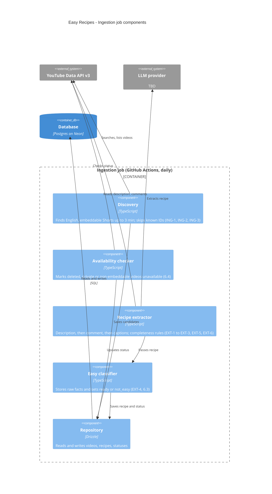

# C4 Level 3: Components of the ingestion job

Status: Proposed

The steps inside the daily ingestion job. Not built yet; this is the plan.

## Notes

- The captions source depends on spike REC-009; until then the extractor
  uses description and comment only (pending decision in
  [`docs/adr/README.md`](../../adr/README.md)).
- The LLM provider is a pending decision; the extractor is the only
  component that depends on it.
- Component names are a plan; the ingestion change must update this diagram
  (and set `Status: Current`).

## Related ADRs

- [0003 Postgres on Neon with Drizzle](../../adr/0003-postgres-neon-drizzle.md)
- [0004 Ingestion on GitHub Actions](../../adr/0004-ingestion-on-github-actions.md)
