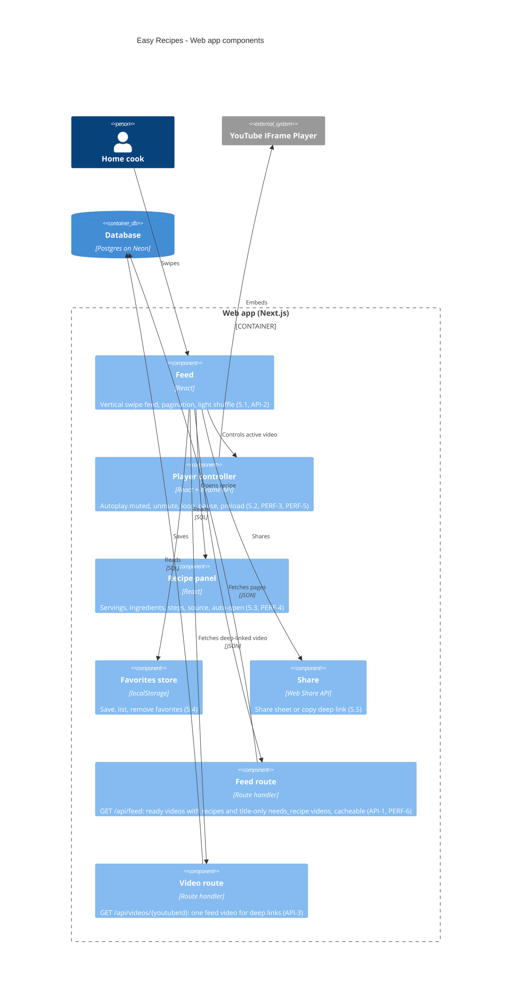

# C4 Level 3: Components of the web app

Status: Proposed

The main parts inside the Next.js app. Not built yet; this is the plan.

## Notes

- The recipe arrives with each feed item, so the panel needs no extra
  request (PERF-4).
- Component names are a plan; the scaffolding change may rename or merge
  them and must update this diagram (and set `Status: Current`).

## Related ADRs

- [0002 Next.js on Vercel](../../adr/0002-nextjs-on-vercel.md)
