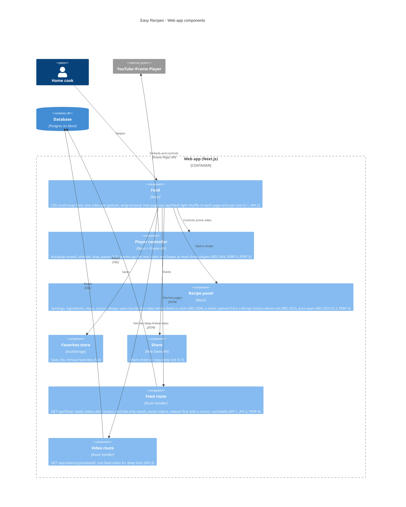

# C4 Level 3: Components of the web app

Status: Proposed

The main parts inside the Next.js app. Built: the Feed, the Feed route, the
Player controller and the Recipe panel and sheet (REC-001 to REC-006, REC-018,
REC-022). Still the plan: the Favorites store, Share, the Video route and the
panel's auto-open (REC-007).

## Notes

- The recipe arrives with each feed item, so the panel needs no extra
  request (PERF-4).
- Built so far (REC-006, change `add-recipe-panel`): the Recipe panel beside the
  video where there are at least 260 px on each side. It is one panel next to
  the feed's scroll container, shown by a CSS rule on the room beside the video,
  and follows the active video. Built since (REC-022, change
  `add-recipe-sheet`): the "Recipe" button over the video, above the unmute
  button's place, and the sheet it opens, where there is no room for the panel
  and the unmute button is over the video; the sheet is also one element next to
  the scroll container, and a turn or resize swaps it with the panel. The button
  beside the video (REC-023) and the auto-open (REC-007) are not built.
- Component names are a plan; the scaffolding change may rename or merge
  them and must update this diagram (and set `Status: Current`).
- Built so far (REC-001, change `add-vertical-swipe-feed`): the Feed and the
  Feed route. The Feed route reads the database as the read-only role since
  REC-002 (change `add-database-feed`), and the Feed shuffles each page it
  receives once per visit.
- Built in REC-003 (change `add-autoplay-playback`): the Player controller,
  for autoplay muted, unmute, sound carried over per tab, loop with an `ended`
  event, and pause and resume. It controls one player per mounted iframe through
  the YouTube IFrame Player API (ADR 0008). REC-004 adds the warm-up of the next video (muted, about a second, then paused) and the cap of three live players (the feed mounts only the active slide and its two neighbours).
  The diagram stays `Proposed` until the other components exist.

## Related ADRs

- [0002 Next.js on Vercel](../../adr/0002-nextjs-on-vercel.md)
- [0008 YouTube IFrame Player API for playback control](../../adr/0008-youtube-iframe-player-api.md)
