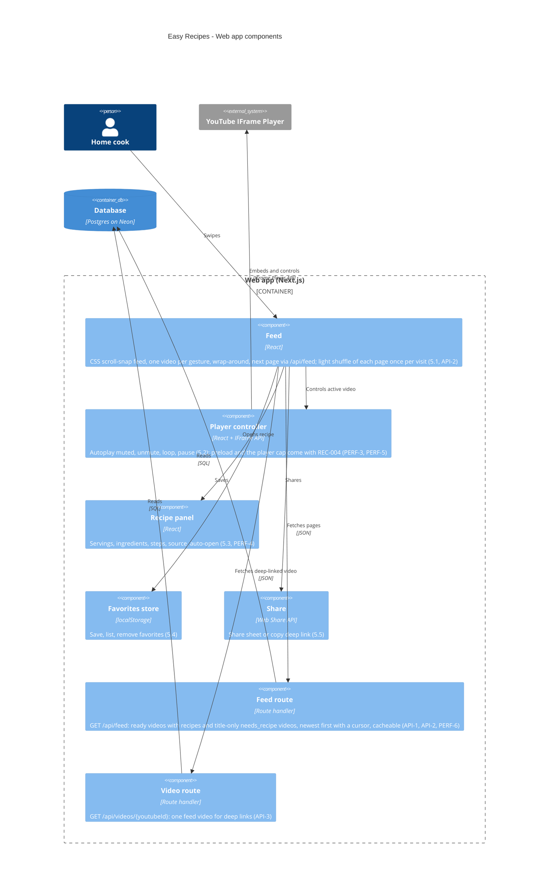

# C4 Level 3: Components of the web app

Status: Proposed

The main parts inside the Next.js app. Feed and the Feed route are built
(REC-001); the other components are still the plan.

## Notes

- The recipe arrives with each feed item, so the panel needs no extra
  request (PERF-4).
- Component names are a plan; the scaffolding change may rename or merge
  them and must update this diagram (and set `Status: Current`).
- Built so far (REC-001, change `add-vertical-swipe-feed`): the Feed and the
  Feed route. The Feed route reads the database as the read-only role since
  REC-002 (change `add-database-feed`), and the Feed shuffles each page it
  receives once per visit.
- Built in REC-003 (change `add-autoplay-playback`): the Player controller,
  for autoplay muted, unmute, sound carried over per tab, loop with an `ended`
  event, and pause and resume. It controls one player per mounted iframe through
  the YouTube IFrame Player API (ADR 0008). Preloading stays REC-004.
  The diagram stays `Proposed` until the other components exist.

## Related ADRs

- [0002 Next.js on Vercel](../../adr/0002-nextjs-on-vercel.md)
- [0008 YouTube IFrame Player API for playback control](../../adr/0008-youtube-iframe-player-api.md)
