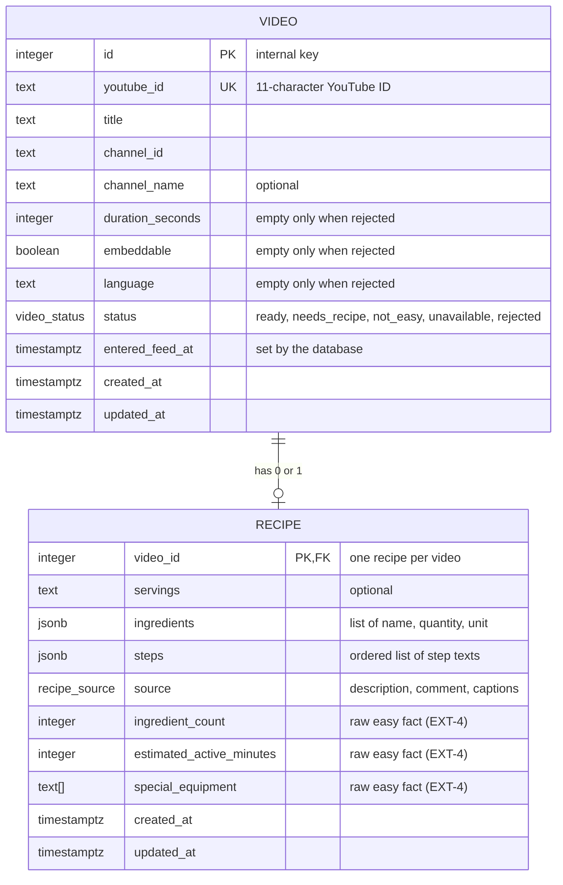

# Data model

Status: Proposed

The logical model of the data Easy Recipes keeps on the server: the videos
found by the daily ingestion job and the recipes extracted from them. It is
the target design that the schema (REC-019), the feed API (REC-002, REC-021)
and the ingestion job (REC-005, REC-008, REC-010) follow. It is not a C4
diagram; see [README](README.md) for the C4 levels.

Sources: PRD v0.3 (§5.3, §6.1–§6.5, EXT-2 to EXT-6, API-1, PERF-4) and the
validated story REC-020, including the decisions in
[`backlog/README.md`](../../backlog/README.md) Decided 4.

## Diagram

Types are Postgres types (ADR 0003). `video_status` and `recipe_source` are
enums. Field names are the database column names.

## Video

One row per YouTube video the ingestion job has processed.

| Field | Type | Required | Meaning |
|---|---|---|---|
| `id` | `integer` | yes | Primary key, internal. Also the tie-breaker in the feed cursor (REC-002). |
| `youtube_id` | `text` | yes | Unique key. Used to skip known videos (ING-3), to embed the player and for deep links (`/r/{videoId}`). The link to the original video is built from it, not stored. |
| `title` | `text` | yes | From the YouTube API. Shown alone for a `needs_recipe` video, and in the Favorites list (REC-012). |
| `channel_id` | `text` | yes | From the YouTube API. Lets extraction prefer the creator's own comment (EXT-2). |
| `channel_name` | `text` | no | From the YouTube API, for display. |
| `duration_seconds` | `integer` | yes, except `rejected` | Candidate fact checked by ING-2 (≤ 180 s). |
| `embeddable` | `boolean` | yes, except `rejected` | Candidate fact checked by ING-2. |
| `language` | `text` | yes, except `rejected` | Candidate fact checked by ING-2 (English). A `rejected` video may have been rejected because a fact was missing. |
| `status` | `video_status` | yes | See [Statuses](#statuses). |
| `entered_feed_at` | `timestamptz` | no | When the video entered the feed. Set by the database (see [Rules](#rules)); empty for a video that has never been in the feed. The feed is ordered by it, newest first (API-2). |
| `created_at`, `updated_at` | `timestamptz` | yes | Housekeeping. |

## Recipe

At most one per video, sharing its key.

| Field | Type | Required | Meaning |
|---|---|---|---|
| `video_id` | `integer` | yes | Primary key and foreign key to `video.id`. |
| `servings` | `text` | no | As written in the source, e.g. "2" or "2–3". |
| `ingredients` | `jsonb` | yes | Ordered list of `{name, quantity, unit}` (EXT-3). See below. |
| `steps` | `jsonb` | yes | Ordered list of step texts; the position is the step number. |
| `source` | `recipe_source` | yes | Where the recipe came from: `description`, `comment` or `captions` (EXT-6). `captions` stays unused unless the REC-009 spike says go. |
| `ingredient_count` | `integer` | yes | Raw "easy" fact from the LLM (EXT-4). |
| `estimated_active_minutes` | `integer` | yes | Raw "easy" fact from the LLM (EXT-4). |
| `special_equipment` | `text[]` | yes | Raw "easy" fact from the LLM (EXT-4); an empty list means common equipment only. |
| `created_at`, `updated_at` | `timestamptz` | yes | Housekeeping. |

The raw "easy" facts are kept so the thresholds (PRD §6.3) can change
without running extraction again (REC-010).

**Ingredient item:**

| Field | Type | Required | Example |
|---|---|---|---|
| `name` | `text` | yes | "flour" |
| `quantity` | `text` | no | "1/2", "a pinch" |
| `unit` | `text` | no | "cup"; empty for "salt to taste" |

Quantity and unit are text and stored as written, because amounts are not
scaled in the MVP.

## Statuses

| Status | Meaning | In the feed | Has a recipe |
|---|---|---|---|
| `ready` | Recipe extracted and judged easy | yes, with its recipe | always |
| `needs_recipe` | No complete recipe found in any source | yes, with its title only | never |
| `not_easy` | Recipe found but fails the easy check (PRD §6.3) | no | always |
| `unavailable` | Video deleted, private or no longer embeddable | no | keeps what it had |
| `rejected` | Candidate that failed the ING-2 checks; kept so it is skipped next time (ING-3) | no | never |

A `needs_recipe` video has no recipe panel (PRD §5.3, PERF-4).

## Rules

1. **Written only when processed.** The ingestion job writes a video only
   with its final status, and writes a `ready` or `not_easy` video together
   with its recipe in one step. There is no "pending" status: a failure
   before the write stores nothing, and the video is found and tried again
   the next day (ING-3 does not skip it).
2. **Time the video entered the feed.** The database sets `entered_feed_at`
   to the current time when a video is inserted as `ready` or
   `needs_recipe`, or changes to one of them from a status outside the
   feed. A change between `ready` and `needs_recipe` keeps the time. So the
   time only grows for videos newly entering the feed, and the feed cursor
   (REC-002) stays stable. How the database does this (for example a
   trigger) is decided in REC-019.
3. **Recipe presence.** `ready` and `not_easy` videos always have a recipe;
   `needs_recipe` and `rejected` videos never do; an `unavailable` video
   keeps whatever it had.

## Notes

- **Built now.** Until E02 (REC-006, REC-008) is built, REC-019 stores the
  recipe as one JSON value on the videos table. This document stays the
  target design and owns the recipe's logical structure.
- **Completeness (EXT-5).** At least 2 ingredients and 2 steps is an
  extraction rule owned by REC-008, not a database constraint.
- **Out of scope.** Favorites live in the browser (REC-011, REC-012) and
  never reach the server. Seed channels and search queries are ingestion
  configuration (REC-005). Adding recipes by hand is out of the MVP
  (`draft-backlog-list.md` D-7).
- **Open.** Whether an ingestion run is stored (for monitoring) is a
  pending decision in [`docs/adr/README.md`](../adr/README.md).
- **Keeping it current.** REC-019 sets this document to `Status: Current`
  once the schema matches it. A story that changes the model updates this
  document in the same change.
