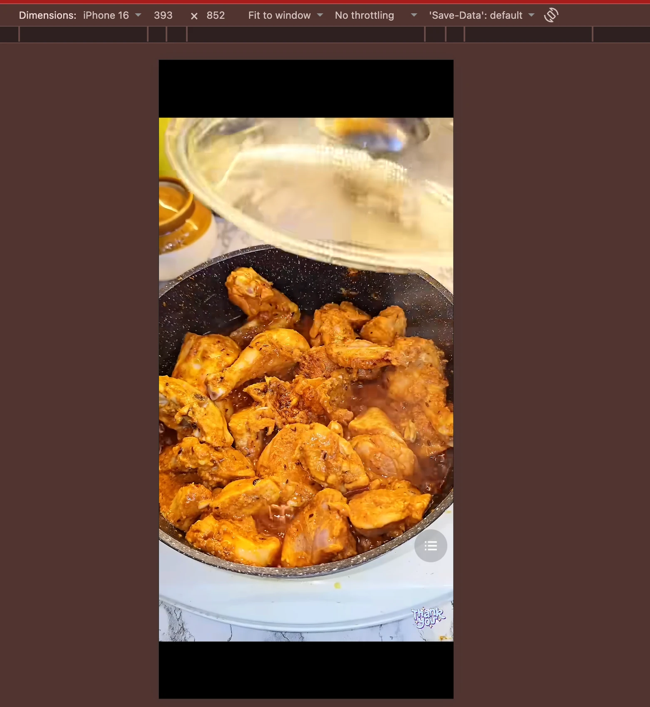
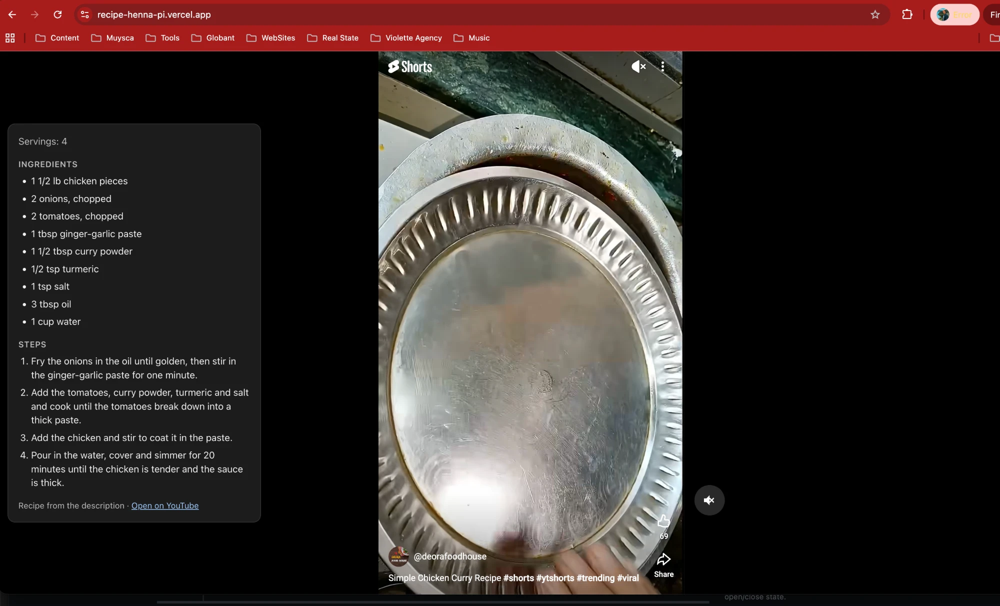
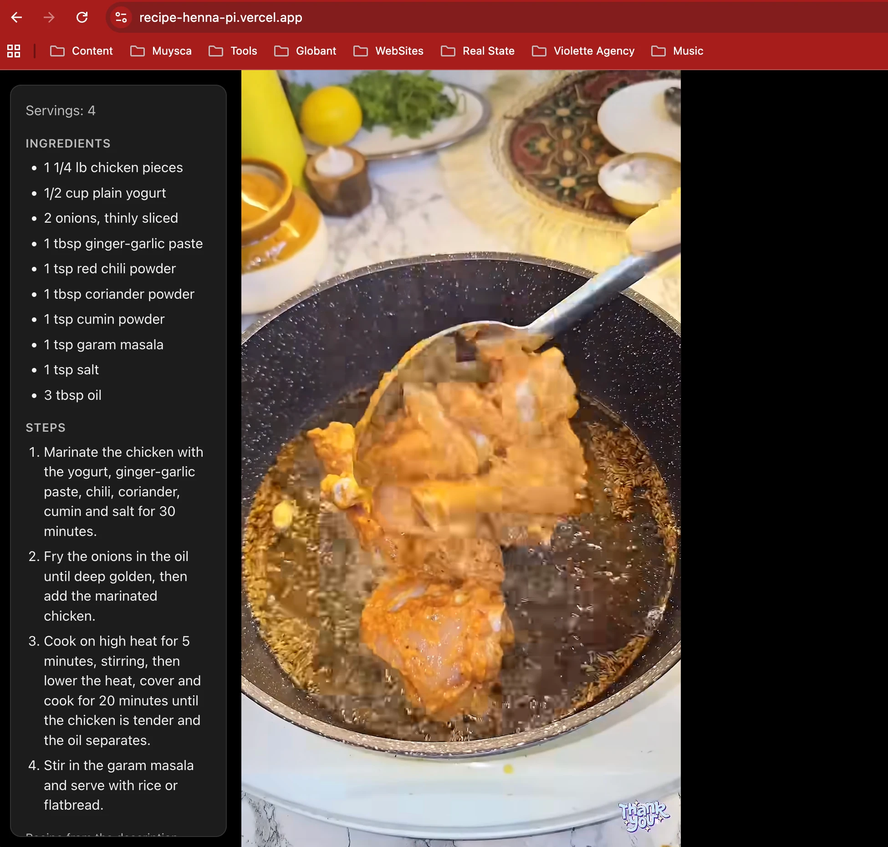
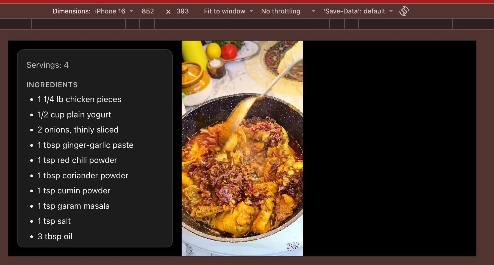
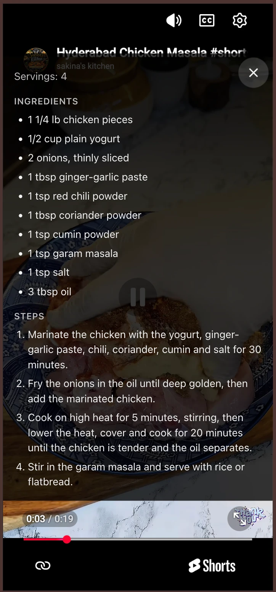

# How to verify the three must-have features

Simple steps to check, by hand, the three features that make the MVP work end
to end: **1. the swipe feed**, **2. playback with sound** and **3. the recipe
next to the video**. Each step says what to do and what you should see. The
screenshots are real captures of the production app on a phone in portrait, a
phone in landscape and a desktop window (Chrome DevTools device mode and a
desktop window).

- **App:** <https://recipe-henna-pi.vercel.app>
- **Needs:** Chrome (or any recent browser) and an internet connection. To try
  the phone layouts on a computer, open DevTools (`F12`), turn on the device
  toolbar (`Ctrl+Shift+M` / `Cmd+Shift+M`) and pick a phone such as
  *iPhone 16* (393 × 852); the rotate icon turns it to landscape (852 × 393).
- **Data:** production serves 24 curated cooking Shorts from the database. 21
  carry a placeholder recipe written from the title (not extracted by the
  LLM, which is not built yet); 3 show their title only. See
  [development.md](development.md#placeholder-recipes-for-the-curated-shorts).

The same behavior is covered by automated tests, listed at the end.

---

## Feature 1: Swipe feed (one video at a time)

*What it is:* a vertical, full-screen feed of cooking Shorts, one per screen.
(Stories REC-001, REC-002, REC-018.)

1. Open the app. **Expect:** a video fills the screen and starts playing at
   once, without any tap. There is no sign-in.
2. Swipe up (on a computer: scroll the mouse wheel or the trackpad).
   **Expect:** the next video snaps into place, one video per swipe, even with
   a hard flick.
3. Swipe down. **Expect:** the previous video comes back. On the first video
   nothing moves backward.
4. Keep swiping to the end. **Expect:** after the last loaded video the next
   page loads by itself, and at the very end the feed wraps to the start.
5. On a desktop window. **Expect:** the video stays centered and keeps a phone
   shape; the sides are black.



*Phone in portrait: one video fills the screen; the round button on the right
is the Recipe button (feature 3).*

---

## Feature 2: Playback (muted autoplay, one tap to unmute)

*What it is:* the active video plays muted, you turn the sound on with one
tap, and only the video on screen plays. (Stories REC-003, REC-004.)

1. Open the app. **Expect:** the video plays by itself with no sound. Browsers
   block unmuted autoplay, so the video starts muted.
2. Tap the unmute button. On a desktop window it sits beside the video, on a
   phone in portrait it is a round icon over the video's bottom right corner.
   **Expect:** the sound turns on and the button disappears.
3. Swipe to the next video. **Expect:** it starts playing right away with the
   sound still on (the choice is kept in this tab), and the video you left
   stops.
4. Let a video play to its end. **Expect:** it loops.
5. Switch to another browser tab and come back. **Expect:** the video paused
   while the tab was hidden and resumes when you return.



*Desktop: the unmute button (round, beside the video's bottom right) and the
recipe panel on the left.*

---

## Feature 3: Recipe next to the video

*What it is:* each video with a recipe shows its servings, ingredients and
numbered steps, and where the recipe came from, without leaving the video.
Where there is room it is a panel beside the video; on a phone in portrait it
opens from a Recipe button as a sheet over the video. A video with no recipe
shows its title only. (Stories REC-006, REC-022.)

### 3a. Panel beside the video (desktop, phone in landscape)

1. Open the app in a desktop window, or in a phone in landscape (852 × 393).
   **Expect:** a recipe panel on the left of the video with *Servings*,
   *Ingredients* and *Steps*.
2. Read to the bottom of a long recipe. **Expect:** a line with the source
   ("Recipe from the description") and an *Open on YouTube* link that opens the
   original video in a new tab.
3. Scroll over the panel. **Expect:** only the panel scrolls; the video does
   not change.
4. Swipe to the next video. **Expect:** the panel changes to that video's
   recipe, from the top. On a video with no recipe the panel is empty.





### 3b. Recipe button and sheet (phone in portrait)

1. Open the app in a phone in portrait (393 × 852). **Expect:** no panel (there
   is no room), and a round Recipe button above the unmute button's place, on
   the video's right edge.
2. Tap the Recipe button. **Expect:** a dark, translucent sheet opens over the
   video with the same recipe; the video keeps playing under it, and the
   player's controls at the top and the bottom stay free.
3. Scroll inside the sheet. **Expect:** only the recipe scrolls; the feed does
   not move.
4. Tap the **X** (or press `Esc`). **Expect:** the sheet closes and the Recipe
   button is back.
5. Open the sheet again and swipe on the video in a free zone, or turn the
   phone to landscape. **Expect:** the sheet closes; in landscape the panel
   takes its place.



---

## Automated tests for these features

Run them from the repository root (setup in [development.md](development.md)):

```bash
pnpm test        # unit tests (Vitest): feed logic, cursor, playback, recipe text
pnpm test:db     # database tests (needs Docker): schema, triggers, feed query
pnpm test:e2e    # end-to-end tests (Playwright, Chromium): the scenarios above
```

| Feature | End-to-end tests |
|---|---|
| Swipe feed | `e2e/feed/` (one video per gesture, wrap, next page, error states) |
| Playback | `e2e/playback/` (muted autoplay, unmute, loop, pause, next video ready) |
| Recipe | `e2e/recipe-panel/` (panel, source, sheet, Recipe button, rotation) |

Every end-to-end test is named after a scenario in `openspec/specs/` and runs
on three screens: phone portrait, phone landscape and desktop. What stays
manual, and why: real touch-flick physics on a phone and the YouTube player's
own controls ([AGENTS.md › E2E rules](../AGENTS.md#end-to-end-e2e-test-rules)).
