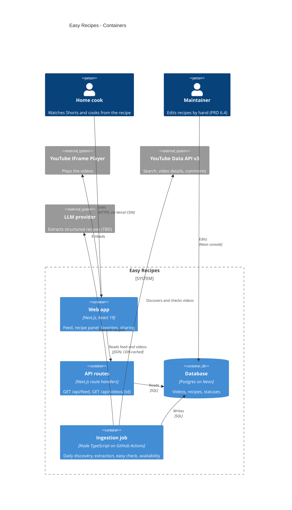

# Design

## Context

No application code exists. The PRD (`docs/PRD.md`) fixes these constraints
on any stack:

- Runtime is read-only: no accounts, favorites live in localStorage (§5.4).
- Data changes in a daily batch: discovery, LLM extraction, availability
  checks (§6.1, §6.2, PERF-1).
- Videos play only in the official YouTube IFrame player (§9), so video
  bandwidth never touches our servers; we serve an app and small JSON.
- Feed responses must be CDN-cacheable (PERF-6); first video < 2 s,
  next video < 500 ms (PERF-2, PERF-3).
- A maintainer edits the database directly (§6.4).
- The §10 roadmap (admin UI, search, accounts, user-submitted URLs) must be
  reachable without a rewrite. See proposal.md - Why.

## Goals / Non-Goals

**Goals:**
- One TypeScript codebase for the web client, the API and the ingestion job.
- Zero servers to operate; free tiers are enough for the MVP.
- Each roadmap item can be added inside the same app.

**Non-Goals:**
- Auth, queues, CSS frameworks, component libraries, state-management
  libraries, analytics: not added until a story needs them.
- Choosing the LLM provider (see Open Questions).
- Writing the data model, API spec or scaffolding (follow-up work).

## Decisions

### Stack

| Layer | Choice |
|---|---|
| Language | TypeScript everywhere |
| Web app + API | Next.js (App Router) with React 19 |
| Styling | Plain CSS modules (CSS scroll snap for the feed) |
| Database | Postgres on Neon (free tier) |
| Data access + migrations | Drizzle ORM (schema and migrations in the repo) |
| Daily ingestion | Node TypeScript script run by a GitHub Actions scheduled workflow |
| External APIs | YouTube Data API v3, YouTube IFrame Player API, LLM provider (TBD) |
| Hosting + CDN | Vercel |
| Package manager / tests | pnpm, Vitest |

### Architecture (C4 level 2: containers)

Levels 1 (system context) and 3 (components of the web app and the ingestion
job) live in `docs/architecture/c4/`. Favorites stay in the browser's
localStorage and are part of the web app container.

- **Request path:** browser -> CDN -> Next.js route -> Postgres. Feed and
  video responses carry `Cache-Control: s-maxage` with revalidation, so most
  requests stop at the CDN (PERF-6).
- **Batch path:** GitHub Actions runs the ingestion script daily. It
  discovers videos, extracts recipes with the LLM, classifies "easy", checks
  availability, and writes to Postgres. It shares types and the Drizzle
  schema with the app. Nothing in the request path calls the LLM (PERF-1).

### Why Next.js + Postgres (option B)

- **Over a static feed (option A: SPA + static JSON, no server):** A is
  simpler and scales traffic best, but it is a dead end for admin UI,
  accounts and user-submitted URLs, which all need server-side writes; adding
  them means rebuilding as B. B with CDN caching gets close to A's traffic
  behavior.
- **Over AdonisJS + React (option C):** C supports the roadmap, but needs a
  long-running server, a separate scheduler and two apps to deploy, which is
  more to operate than the MVP warrants.

### Why ingestion runs on GitHub Actions, not Vercel Cron

Vercel functions have time limits; a batch of LLM calls can exceed them.
Actions jobs run for up to 6 hours, are free for this volume, and keep the
batch out of the request path. A queue (for user-submitted URLs) is added
only when that roadmap item is taken.

### Why Neon + Drizzle

Postgres handles the catalog well past the MVP and offers full-text search
for the future search feature. Neon's free tier and web console cover the
maintainer's manual edits (§6.4). Drizzle is a thin, type-safe layer whose
schema is shared by the app and the ingestion script. Alternatives: SQLite
(simpler, but one writer and hard to share between Vercel and Actions);
Prisma (heavier runtime and generation step).

### Architecture documentation: C4 in Mermaid

C4 levels 1–3 are written as Mermaid `C4Context`, `C4Container` and
`C4Component` diagrams, one Markdown file per diagram in
`docs/architecture/c4/`. Level 4 (code) is skipped; the code itself is the
source for it. Each file has a `Status:` line: `Proposed` for parts not built
yet, `Current` once the code exists.

Alternatives: Structurizr DSL (best C4 tooling, but needs a separate tool or
server to render); PlantUML C4 (needs Java or a render server); image files
(cannot be diffed or edited by agents). Mermaid needs no tools, renders on
GitHub, and diffs as text.

### Decision records: ADRs

One file per decision in `docs/adr/NNNN-<slug>.md`, using a short MADR-style
template: Status (`Proposed` | `Accepted` | `Superseded by NNNN`), Date,
Context, Decision, Alternatives, Consequences, Links. `docs/adr/README.md`
holds the index and a "Pending decisions" list for decisions not made yet
(no empty ADR files). Numbers are never reused; an `Accepted` ADR is never
edited, only superseded by a new one.

Alternatives: full MADR (more sections than this project needs); one
decisions log file (hard to supersede and link a single decision).

This change's decisions map to ADRs:

| ADR | Decision |
|---|---|
| 0001 | Record architecture decisions as ADRs, with C4 diagrams in Mermaid |
| 0002 | Next.js (App Router) on Vercel for the web app and API |
| 0003 | Postgres on Neon with Drizzle ORM |
| 0004 | Daily ingestion as a TypeScript script on GitHub Actions |

Pending decisions at the time of this change: LLM provider; captions source
(depends on spike REC-009); whether favorites store a copy of the recipe.

### Keeping ADRs and C4 current

- **`write-adr` skill:** creates the next numbered ADR from the template,
  adds it to the index, marks any superseded ADR, then identifies the
  affected C4 diagrams and updates them.
- **Rule in `AGENTS.md`:** every architecture decision gets an ADR; any
  change to a container, component or external system updates the matching
  C4 diagram in the same change.
- **Rule in `openspec/config.yaml`** (for `design` and `tasks`): a design
  that makes an architecture decision names the ADR(s) to write and the C4
  levels to update, and its tasks include those steps. This makes every
  future OpenSpec change carry its own documentation updates.

## Risks / Trade-offs

- [YouTube API quota: 10,000 units/day by default, a search costs 100] →
  Prefer seed channels over searches; the daily job caches results (PRD §9).
- [Neon free tier pauses when idle, adding a cold start] → Feed responses
  are CDN-cached, so most users never reach the database; upgrade the plan
  if PERF-2 fails on the REC-015 device check.
- [Next.js is a large framework for a small app] → Use only App Router
  pages and route handlers; no extra libraries until a story needs them.
- [Vendor lock-in to Vercel] → Standard Next.js runs elsewhere (Node server
  or other hosts); Postgres and Drizzle are portable.
- [LLM provider not chosen] → The extraction step is isolated in the
  ingestion script, so the choice does not affect the rest of the stack.
- [Mermaid C4 support is still marked experimental; layout control is
  limited] → Keep each diagram small (one level, one scope); if a diagram
  does not render on GitHub, fall back to a `flowchart` with C4-style labels.
- [Docs drift from the code] → The `AGENTS.md` and `openspec/config.yaml`
  rules put ADR and C4 updates into the tasks of each change, and the
  `Status:` line shows which diagrams are still `Proposed`.

## Migration Plan

Not applicable: there is no existing system. Rollback is reverting the
documentation edits.

## Open Questions

- Which LLM provider and model to use for extraction (needs structured JSON
  output). Can be decided in the ingestion/extraction change without
  affecting this stack.
